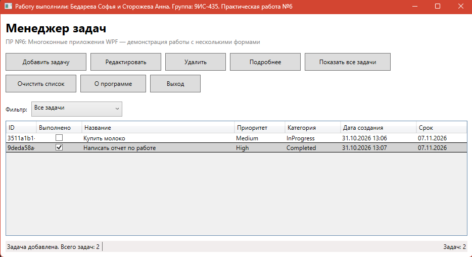

**English** | [Russian](README.md)
# README

## Practical Work No. 6: Developing a Multi-Form Application in WPF and C#

---
## Project Description

**Name:** TaskTracker ("Task Manager")

**Purpose:** an educational WPF application for maintaining a task list — with adding, editing, deleting, viewing details, and filtering by status.

**Demonstrated approaches:**

- Multi-window WPF application (`MainWindow`, `AddTaskWindow`, `TaskDetailsWindow`).
- Passing data between forms via **properties** (`Result`) and the **constructor**.
- **Singleton** pattern for the task storage (`TaskManager.GetTaskManager`).
- **MVVM-like** data binding (`Binding`, `DataContext`, `INotifyPropertyChanged`).
- **ObservableCollection** as the data source for `DataGrid` — automatic UI updates.
- Separation of logic and UI (validation returns `bool`, the window displays messages).

---
## Objective

Consolidate theoretical knowledge on the topic "Creating multi-window WPF applications" and gain practical skills in developing windowed applications in C# using multiple forms (`Window`), organizing navigation between them, and passing data. Implement a "Task Manager" application demonstrating work with multiple forms and the **Singleton** pattern for business logic.

---

## Functionality

| # | Button / feature | Action |
|---|---|---|
| 1 | **Add task** | Opens `AddTaskWindow`; after "Save" the task is added to the collection and to `TaskManager`, and a message with the total count is shown |
| 2 | **Edit** | Opens `AddTaskWindow` in edit mode with the selected task; changes are immediately visible in the table thanks to `INotifyPropertyChanged` |
| 3 | **Delete** | Requests confirmation, removes the task from `TaskManager` and from the `ObservableCollection`, and shows the number remaining |
| 4 | **Details** | Opens `TaskDetailsWindow` with full data; allows toggling the "completed / in progress" status |
| 5 | **Show all tasks** | Resets the filter to "All tasks" and shows the list again |
| 6 | **Clear list** | Requests confirmation, calls `ClearAllTasks()`, and clears the table |
| 7 | **About** | `MessageBox` with full name, group, application name, and version |
| 8 | **Exit** | Requests confirmation and terminates the application |
| 9 | **Filter** (ComboBox) | Shows "All / Active / Completed" tasks |
| 10 | **Double-click on a row** | Opens the "Details" window for the selected task |

**UI controls:** 8 buttons, ComboBox, DataGrid, StatusBar, 2 TextBlocks — more than the minimum (6).

---

## Architecture and Implementation

### Project structure

```
TaskTracker/
├── App.xaml / App.xaml.cs
├── MainWindow.xaml / MainWindow.xaml.cs          — main window
├── AddTaskWindow.xaml / AddTaskWindow.xaml.cs    — add/edit
├── TaskDetailsWindow.xaml / TaskDetailsWindow.xaml.cs — details
├── TaskItem.cs                                   — task model
├── TaskManager.cs                                — business logic (Singleton)
└── EnumHelper.cs                                 — helper for ComboBox with enum
```

### Key classes

**`TaskItem`** — the task model, implements `INotifyPropertyChanged`. Properties: `Id`, `Title`, `Description`, `CreatedAt`, `Priority` (`High/Medium/Low/Undefined`), `Deadline`, `Category` (`NotStarted/InProgress/Completed`), as well as the read-only `IsCompleted`.

**`TaskManager`** — the task storage, implemented as a **Singleton**:

```csharp
private static readonly TaskManager _instance = new();
public static TaskManager GetTaskManager => _instance;
private TaskManager() { }        // private constructor
private readonly List<TaskItem> tasks = new();
```

A private constructor + a static field + a public getter property — the classic **Singleton** pattern implementation (thread-safe during static field initialization by the CLR).

**`EnumHelper`** — a static class for binding enum values in a ComboBox:

```csharp
public static Array Priorities => Enum.GetValues(typeof(TaskPriority));
public static Array Categories => Enum.GetValues(typeof(TaskCategory));
```

In XAML it is used as `{Binding Source={x:Static local:EnumHelper.Priorities}}`.

**`MainWindow`** — implements `INotifyPropertyChanged` and has two `ObservableCollection`s:

- `Tasks` — the "source of truth", synchronized with `TaskManager`;
- `VisibleTasks` — what is actually visible in the `DataGrid` after filtering.

Communication between windows:

```
MainWindow ──AddTaskWindow.Result──▶ Tasks.Add(...)
MainWindow ──new AddTaskWindow(SelectedTask)──▶ editing
MainWindow ──new TaskDetailsWindow(SelectedTask)──▶ viewing
```

### Interaction diagram

```
          ┌──────────────────┐
          │   TaskManager    │  (Singleton)
          │  List<TaskItem>  │
          └────────┬─────────┘
                   │ GetAllTasks / AddTask / RemoveTask / ClearAllTasks
                   ▼
          ┌──────────────────┐       ┌──────────────────┐
          │   MainWindow     │──────▶│  AddTaskWindow   │
          │ ObservableCollection │   │  (Result/task)   │
          └────────┬─────────┘       └──────────────────┘
                   │
                   ▼
          ┌──────────────────┐
          │ TaskDetailsWindow│
          └──────────────────┘
```

---

## Business Logic

### `TaskManager` class

| Method / property | Description |
|---|---|
| `static TaskManager GetTaskManager` | Returns the single instance (Singleton) |
| `int Count` | Number of tasks in storage |
| `List<TaskItem> GetAllTasks()` | Returns the list of all tasks |
| `bool AddTask(string title, string description)` | Adds a task; `false` if `title` is empty |
| `bool AddTask(TaskItem task)` | Adds a ready-made object; `false` if `Title` is empty |
| `bool RemoveTask(TaskItem task)` | Removes a task; `true` if found and removed |
| `void ClearAllTasks()` | Clears the list |

### `TaskItem` class

| Property | Type | Description |
|---|---|---|
| `Id` | `string` | GUID, generated on creation |
| `Title` | `string` | Task title |
| `Description` | `string` | Description |
| `CreatedAt` | `DateTime` | Creation date and time (defaults to `DateTime.Now`) |
| `Priority` | `TaskPriority` | Priority |
| `Deadline` | `DateTime` | Due date |
| `Category` | `TaskCategory` | Category / status |
| `IsCompleted` | `bool` (read-only) | `Category == Completed` |

---

## Implementation Details

- **Singleton with thread-safe initialization** — the static `readonly` field is initialized once by the CLR; all windows get the same instance via `TaskManager.GetTaskManager`.
- **`INotifyPropertyChanged`** in `TaskItem` and `MainWindow` — model changes are instantly reflected in the `DataGrid` without `Items.Refresh()`.
- **`ObservableCollection`** — adding/removing in the collection automatically updates the UI.
- **Separation of logic and UI:** `TaskManager` does not show `MessageBox`; validation returns `bool`, and messages are shown by the window. This simplifies testing.
- **Two-phase confirmation:** all destructive operations (delete, clear, exit) request `MessageBox.YesNo`.
- **Passing data between forms:** via the `Result` property (add window) and a constructor with a `TaskItem` parameter (edit/details window). After `ShowDialog() == true`, the main window retrieves the result.
- **Filtering** is implemented via a second `ObservableCollection` `VisibleTasks` — `DataGrid.ItemsSource` is bound to it, while `Tasks` remains the full list.
- **Input error handling:** an empty `Title` prevents saving the task (message + `return`).
- **`DataGridCheckBoxColumn` read-only** (via `Mode=OneWay` or `IsReadOnly="True"`) — avoids the `TwoWay binding to read-only property` exception, while the status is still displayed clearly.

---

## Requirements and Launch

**Requirements:**

- .NET SDK **8.0** or newer
- Windows 10/11
- Visual Studio 2022 (or the `dotnet` CLI)
- Language: C# 12
- UI framework: WPF

**Build and run:**

```bash
dotnet build
dotnet run
```

**Or via Visual Studio:** open `TaskTracker.sln` → F5.

---

## Example Usage

**Scenario:**

1. Launch → empty table, counter "Tasks: 0".
2. "Add task" → enter `Buy milk`, select `Medium`, `NotStarted`, due date `11/01/2026` → "Save".
3. A `MessageBox` appears: *"Task added. Total tasks: 1"*, and the row appears in the table.
4. Select the row → "Details" → a window opens with full data and a "✓ Mark as completed" button.
5. After clicking, the status changes to `Completed`, and a checkmark appears in the main table.
6. Filter "Active" — the task disappears from view (since it is completed).
7. "Delete" → Yes → *"Task deleted. Total tasks: 0"*.

**Main window screenshot:**



---

## Compliance with Requirements

| Manual requirement | Status |
|---|---|
| No. 1. Three forms: `MainWindow`, `AddTaskWindow`, `TaskDetailsWindow` | ✅ |
| No. 1. Window properties (`Title`, `Width`, `Height`, `WindowStartupLocation`) | ✅ |
| No. 2. `TaskManager` stores `List<TaskItem>` | ✅ |
| No. 2. `AddTask(string, string)` | ✅ |
| No. 2. `GetAllTasks()`, `ClearAllTasks()`, `Count` | ✅ |
| No. 2. `TaskItem`: `Title`, `Description`, `CreatedAt` | ✅ (+ `Priority`, `Deadline`, `Category`, `Id`) |
| No. 3. At least 6 buttons with logic | ✅ **8 buttons** |
| No. 3. "Show all tasks" button | ✅ |
| No. 3. "Clear list" button | ✅ |
| No. 3. "About" button | ✅ |
| No. 3. "Exit" button | ✅ |
| No. 4. Passing data `AddTaskWindow` → `MainWindow` | ✅ via `Result` |
| No. 4. Passing `TaskItem` to `TaskDetailsWindow` | ✅ via constructor |
| No. 5. Confirmation messages with task counts | ✅ after add / delete / clear |
| No. 5. Handling "no task selected" | ✅ for "Edit" / "Delete" / "Details" |
| Additional: filter by status | ✅ bonus |
| Additional: double-click → details | ✅ bonus |
| Additional: status bar with counter | ✅ bonus |

**Final grade: 5 (excellent)** — all 5 mandatory requirements are met (criterion "5"), plus additional improvements are implemented: filtering, Singleton storage, MVVM-like binding, `INotifyPropertyChanged`, and a details window with status toggling.
